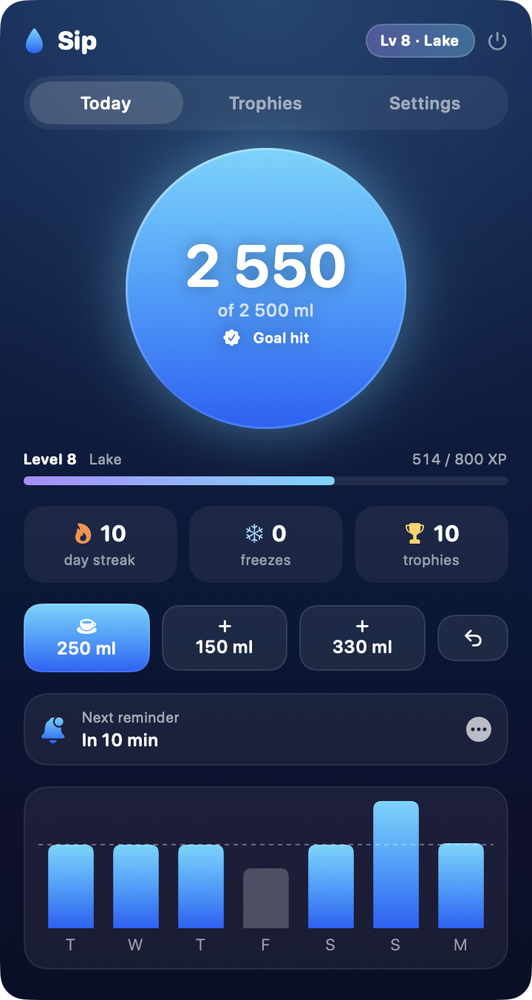
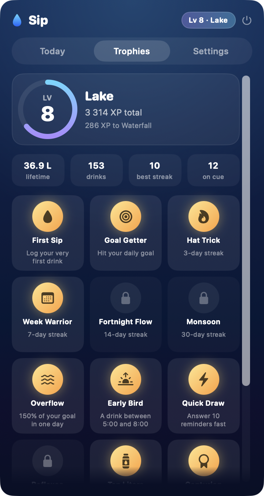
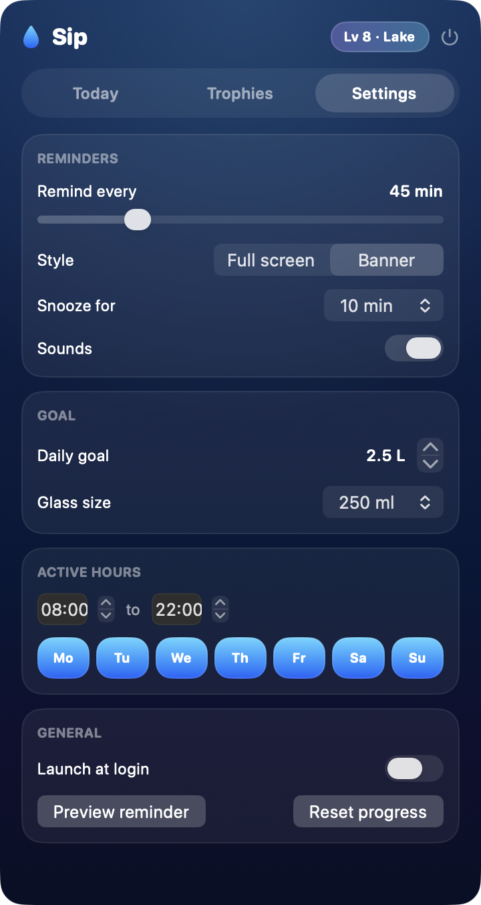

# Sip 💧

**A hydration coach for people who forget to drink water.** Sip lives in your Mac's menu bar and, at the interval you choose, rises over your screen until you drink. Every glass earns XP, levels and streaks.

<p align="center">
  
  
  
</p>

## What it does

- **Reminder overlay.** At each interval a frosted-glass reminder covers every display and Space, full-screen apps included. Log a glass, pick another amount, snooze or skip. With the lock timer off, <kbd>Return</kbd> logs a glass and <kbd>Esc</kbd> snoozes. Input is ignored for the first second, so a keystroke meant for another app can't log a drink by accident. If you'd rather not be interrupted that hard, switch to a corner **banner**, which never takes the keyboard.
- **Bottle plan.** Tell Sip your bottle and how many sips you split it into. The default is a 1750 ml bottle in 8 sips between 08:00 and 17:00: 219 ml per reminder, one every 68 minutes, so exactly 8 fit your day. The glass in the menu bar panel shows a mark for each sip, and reminders go quiet once the bottle is finished. Checking in is a single button for your sip (or any glass size you pick); set **Check-in buttons** per bottle (1–4) if you also want other amounts to pick from.
- **Lock timer.** The full-screen reminder can lock itself for a time you choose (default 1 minute). While the countdown runs there's nothing to click away, so you go get water instead of snoozing. When it unlocks, you tick an "I drank it" box, captcha style. Holding the emergency button for 3 seconds snoozes it if you really can't. Set **Snooze** to *Off* and there's no snooze, skip or emergency button at all, and Pause disappears from the menu bar: drinking is the only way past.
- **Drinking resets the clock.** Log a drink from the menu bar at any time and the next reminder moves to a full interval later.
- **Your hours, your days.** Set active hours (overnight windows like 20:00 to 02:00 work) and pick which weekdays remind you. A reminder that came due while the Mac slept shows once when it wakes, and never outside your active hours.
- **Menu bar at a glance.** The drop icon fills up as you approach your goal. The panel shows a live water glass, an XP bar, your streak, quick-add buttons, a countdown to the next reminder and a 7-day chart.

## The game

| You do | You get |
| --- | --- |
| Drink | 1 XP per 25 ml (counted up to 150% of your daily goal) |
| Answer a reminder within 2 minutes | +5 XP "on cue" bonus |
| Hit your daily goal | +50 XP, plus 5 XP × streak length (max +100) |
| Unlock a trophy | 25–500 XP |

- **Levels:** 14 ranks, from *Dry Sponge* up to *Poseidon*. Level *n* needs 50·n·(n−1) XP in total.
- **Streaks:** consecutive days on which you hit your goal. Weekdays you've switched off never break a streak.
- **Freezes:** every 7 streak days earn a freeze (you can hold 2). A freeze covers one missed day automatically.
- **13 trophies:** First Sip, Hat Trick, Week Warrior, Monsoon (a 30-day streak), Early Bird, Quick Draw, Comeback Kid and more.

All progress is recalculated from your drink log, so undoing a drink or changing your goal never leaves your stats in a broken state.

## Install

Requires macOS 26 and Xcode 26 or newer.

```bash
git clone https://github.com/kradyy/sip.git && cd sip
./scripts/build-app.sh --install
```

This builds `Sip.app`, copies it to `/Applications` and launches it. Look for the 💧 in your menu bar. Turn on **Settings → Launch at login** so it starts with your Mac.

## Develop

```bash
swift test                 # core logic test suite
swift run Sip              # run without bundling (shows a Dock icon)
```

| Path | What |
| --- | --- |
| `Sources/SipCore` | Pure logic: scheduling, XP, streaks, freezes, trophies. No UI, fully tested. |
| `Sources/Sip` | SwiftUI and AppKit app: menu bar panel, overlay windows, persistence. |
| `Tests/SipCoreTests` | Swift Testing suite, covering DST, overnight windows and streak edge cases. |

Test hooks: `--show-reminder` opens a preview reminder at launch, `--preview-panel today|trophies|settings` opens the panel in a normal window, and `SIP_STATE_DIR=/tmp/x` points the app at a throwaway state file.

## Privacy

Everything stays on your Mac in `~/Library/Application Support/Sip/state.json`. Sip has no network code, accounts or analytics.
